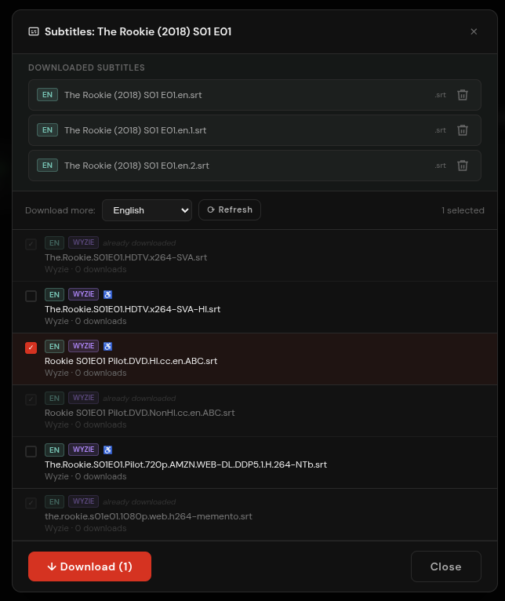

# ✨ Lumora

  <strong>A Cinematic Media Experience</strong>

  Discover. Watch. Enjoy.

  A modern desktop media application for discovering and enjoying Movies, TV Series, and Anime.

  

  
  
  
  

---

## Overview

**Lumora** is a cinematic desktop media application built with Electron and React.

Designed to deliver a modern entertainment experience, Lumora brings media discovery, streaming, downloads, and personal library management into one elegant desktop application.

With an immersive interface, smooth navigation, and customizable settings, Lumora aims to make entertainment feel effortless.

## Features

- 🎬 **Media Discovery** — Explore movies, TV series, and anime.
- ▶️ **Streaming** — Watch available media through supported sources.
- 📥 **Download Manager** — Download and organize supported media.
- 💬 **Subtitle Support** — Download and manage subtitles.
- 📚 **Personal Library** — Keep track of watched and saved content.
- ✨ **Trending** — Discover popular and trending entertainment.
- 🎨 **Customization** — Personalize the interface and application settings.
- 🎮 **Gamepad Support** — Navigate supported application features using a controller.
- ⌨️ **Keyboard Shortcuts** — Navigate and control playback efficiently.
- 🎵 **Discord Rich Presence** — Display supported media activity on Discord.

## Screenshots

Explore the Lumora interface:

---

## Technology

Lumora is built using modern desktop application technologies.

| Technology | Purpose |
|---|---|
| Electron | Desktop application framework |
| React | User interface |
| Vite | Build tooling |
| JavaScript | Application logic |
| CSS | Interface styling |
| TMDB API | Media metadata |

---

## Requirements

Before running Lumora from source, make sure you have:

- [Node.js](https://nodejs.org/) version 22.12.0 or newer.
- npm package manager.
- A TMDB API Read Access Token.
- [FFmpeg](https://ffmpeg.org/download.html) for supported media operations.

See [TMDB Tutorial](tmdb-tutorial.md) for instructions on obtaining an API token.

## Installation

### macOS

1. Visit the [Lumora Releases](https://github.com/febrianaulia/Lumora/releases) page.
2. Download the latest available macOS `.dmg` installer.
3. Open the downloaded DMG file.
4. Drag Lumora into the Applications folder.
5. Launch Lumora.

On first launch, you may
