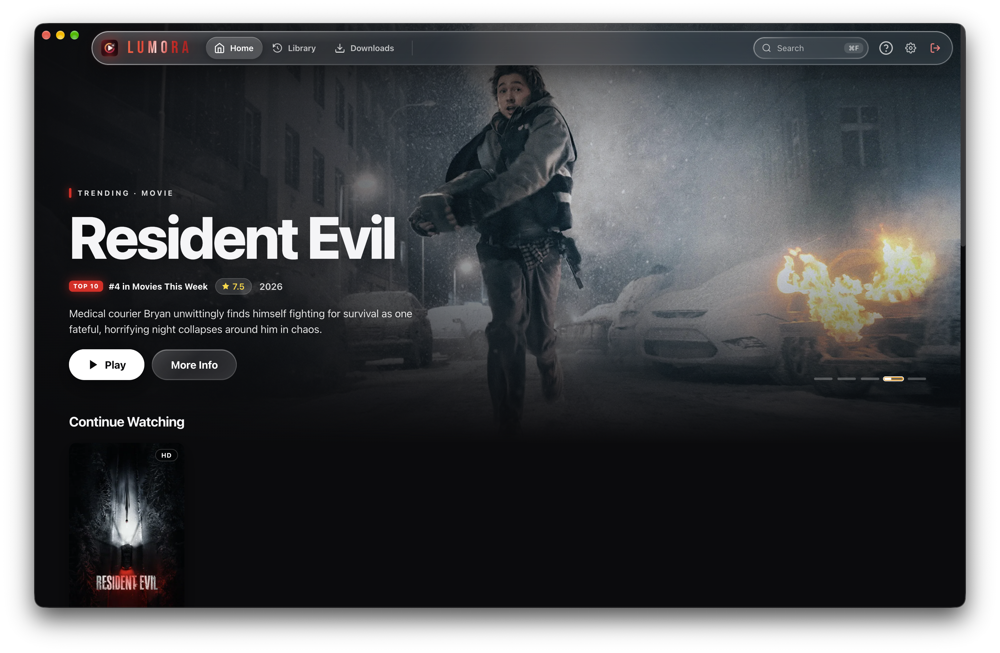
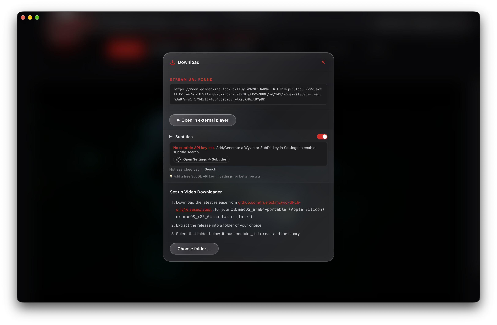

# Lumora

<p align="center">
  
</p>

<h1 align="center">Lumora</h1>

<p align="center">
  <strong>A Cinematic Media Experience</strong>
</p>

<p align="center">
  Discover. Watch. Enjoy.
</p>

<p align="center">
  A modern desktop media application designed to bring movies, TV series, and anime together in one cinematic experience.
</p>

<p align="center">
  
  
  
  
</p>

---

## Overview

**Lumora** is a cinematic desktop media application built with Electron and React.

Designed around a modern entertainment experience, Lumora brings media discovery, streaming, downloads, and personal library management into one elegant desktop application.

With an immersive interface, smooth navigation, and customizable settings, Lumora aims to make entertainment feel effortless.

## Features

- 🎬 **Media Discovery** — Explore movies, TV series, and anime.
- ▶️ **Streaming** — Watch media through supported third-party sources.
- 📥 **Download Manager** — Download and organize supported media.
- 💬 **Subtitle Support** — Download and manage subtitles.
- 📚 **Personal Library** — Keep track of watched and saved content.
- ✨ **Trending** — Discover popular and trending entertainment.
- 🎨 **Customization** — Personalize the interface and application settings.
- 🎮 **Gamepad Support** — Navigate supported features using a controller.
- ⌨️ **Keyboard Shortcuts** — Navigate and control the application efficiently.
- 🎵 **Discord Rich Presence** — Display supported media activity on Discord.

---

## Screenshots

<p align="center">
  
  <br/>
  <em>Discover trending entertainment</em>
</p>

<p align="center">
  
  <br/>
  <em>Explore TV series</em>
</p>

<p align="center">
  
  <br/>
  <em>Enjoy your favorite movies</em>
</p>

<p align="center">
  
  <br/>
  <em>Discover anime</em>
</p>

<p align="center">
  
  <br/>
  <em>Customize your experience</em>
</p>

<p align="center">
  
  <br/>
  <em>Manage your downloads</em>
</p>

---

## Technology

| Technology | Purpose |
|---|---|
| Electron | Desktop application framework |
| React | User interface |
| Vite | Development and build tooling |
| JavaScript | Application logic |
| CSS | Interface styling |
| TMDB API | Media metadata |

## Requirements

Before running Lumora from source, make sure you have:

- [Node.js](https://nodejs.org/) version 22.12.0 or newer.
- npm package manager.
- A TMDB API Read Access Token.
- [FFmpeg](https://ffmpeg.org/download.html) for supported media operations.

See [TMDB Tutorial](tmdb-tutorial.md) for instructions on obtaining an API token.

---

## Installation

On first launch you'll be prompted to enter your TMDB API key. ([Guide on how to get one](tmdb-tutorial.md))

It's saved locally, you only need to do this once.

### macOS

1. Visit the [Lumora Releases](https://github.com/febrianaulia/Lumora/releases) page.
2. Download the latest available macOS `.dmg` installer.
3. Open the downloaded DMG file.
4. Drag Lumora into the Applications folder.
5. Launch Lumora.

If macOS blocks the application because it is not signed and notarized, authorization may be required through System Settings → Privacy & Security.

### Windows (x64)

1. Visit the [Lumora v2.7.0 Release](https://github.com/febrianaulia/Lumora/releases/tag/v2.7.0).
2. Download `Lumora.Setup.2.7.0.exe`.
3. Run the installer and follow the installation instructions.
4. Launch Lumora from the Start menu or desktop shortcut.

**Note:** The Windows installer is currently unsigned. Windows SmartScreen may display a security warning when launching the installer. Only download Lumora from the official GitHub repository.

### Linux

A Linux installer is not currently available. Linux support may be provided in future releases.

---

## Building from Source

### 1. Clone the repository

```bash
git clone https://github.com/febrianaulia/Lumora.git
cd Lumora
```

### 2. Install dependencies

```bash
npm install
```

### 3. Start the application

Use the development command configured in `package.json`.

```bash
npm run dev
```

### 4. Build for macOS

```bash
npm run dist:mac
```

### Other build commands

```bash
npm run dist:win
npm run dist:linux
npm run dist:deb
npm run dist:rpm
npm run dist:appimage
```

Refer to `package.json` for the available scripts.

---

## Automated Builds

Lumora uses GitHub Actions to automate application builds.

The build workflow can:

- Install project dependencies.
- Prepare the Electron environment.
- Build the application.
- Generate macOS installation packages.
- Upload build artifacts.

Visit [GitHub Actions](https://github.com/febrianaulia/Lumora/actions) to view workflow history and available artifacts.

---

## About the Developer

<p align="center">
  <strong>Febrian Aulia</strong>
  <br/>
  Founder & Developer of Lumora
  <br/>
  📍 Bukittinggi, Indonesia 🇮🇩
</p>

<p align="center">
  Lumora is an independent project developed with a passion for technology, software development, and cinematic entertainment experiences.
</p>

---

## Credits & Acknowledgements

Lumora is an independently maintained modified derivative of the open-source **[Streambert](https://github.com/truelockmc/streambert)** project.

We sincerely appreciate the original developer, [@truelockmc](https://github.com/truelockmc), and all contributors for their work and contributions to the open-source community.

Lumora introduces its own visual identity, interface modifications, and further development while retaining the original project's applicable license and attribution requirements.

The original project and its respective authors retain credit for their contributions.

Lumora is not an official product or release of the original Streambert developers.

---

## License

Lumora is distributed under the **GNU General Public License v3.0 (GPL-3.0)**.

See the [LICENSE](LICENSE) file for the complete license terms.

As a derivative project, Lumora respects the applicable obligations of the original GPL-3.0 license, including preservation of copyright notices and license information.

---

## Legal Disclaimer

Lumora does not host or store third-party copyrighted media content.

Media availability depends on external providers and services. Users are responsible for ensuring that their use of the application complies with applicable laws and the terms of those services.

## Privacy

Lumora does not operate its own centralized media hosting service.

However, external APIs, media providers, and integrated third-party services may process user requests and associated information under their own privacy policies.

---

<p align="center">
  
</p>

<h2 align="center">Lumora</h2>

<p align="center">
  <strong>A better way to experience entertainment.</strong>
</p>

<p align="center">
  Created with passion in Bukittinggi, Indonesia.
</p>

<p align="center">
  <a href="https://github.com/febrianaulia/Lumora">GitHub Repository</a>
  ·
  <a href="https://github.com/febrianaulia/Lumora/releases">Releases</a>
  ·
  <a href="https://github.com/febrianaulia/Lumora/issues">Report an Issue</a>
</p>
