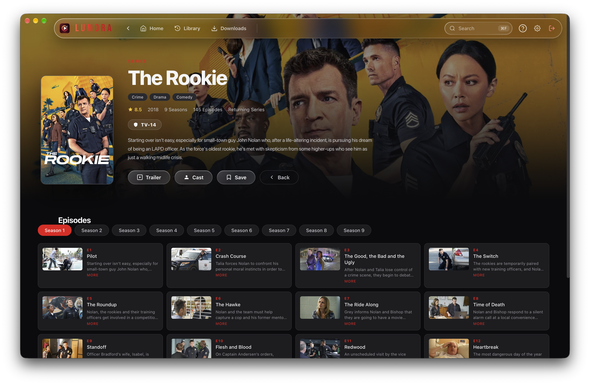
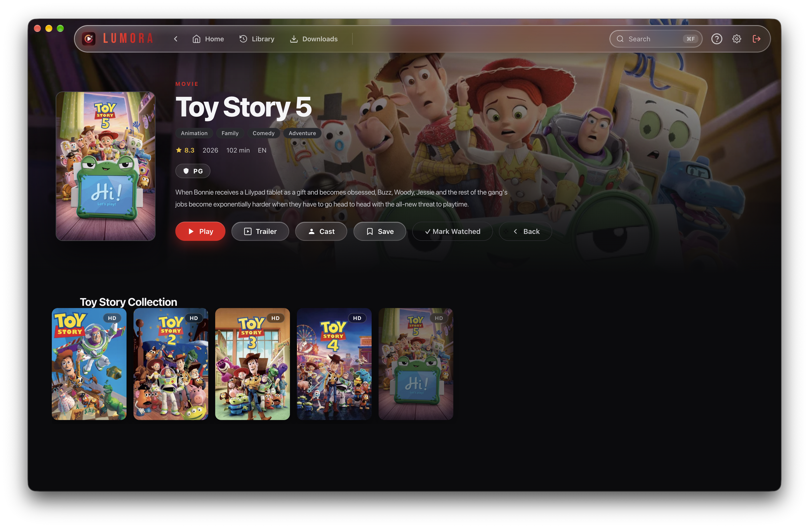
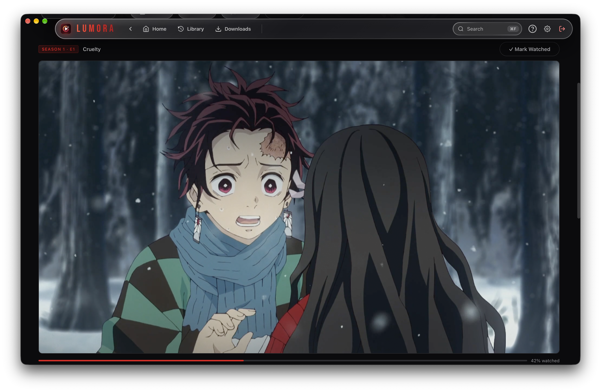
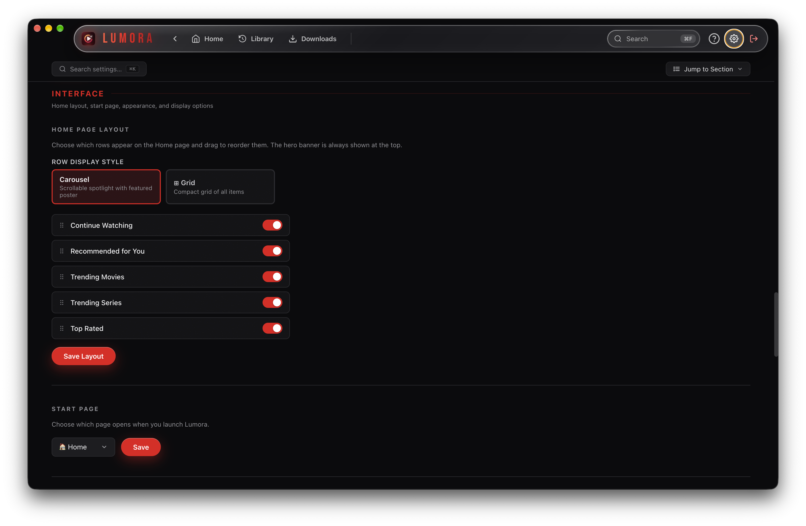

# ✨ Lumora

<p align="center">
  <strong>A Cinematic Media Experience</strong>
</p>

<p align="center">
  Discover. Watch. Enjoy.
</p>

<p align="center">
  A modern desktop media application for discovering and enjoying Movies, TV Series, and Anime.
</p>

<p align="center">
  
</p>

<p align="center">
  
  
  
  
</p>

---

## Overview

**Lumora** is a cinematic desktop media application built with Electron and React.

Designed to deliver a modern entertainment experience, Lumora brings media discovery, streaming, downloads, and personal library management into one elegant desktop application.

With an immersive interface, smooth navigation, and customizable settings, Lumora aims to make entertainment feel effortless.

## Features

- 🎬 **Media Discovery** — Explore movies, TV series, and anime.
- ▶️ **Streaming** — Watch available media through supported sources.
- 📥 **Download Manager** — Download and organize supported media.
- 💬 **Subtitle Support** — Download and manage subtitles.
- 📚 **Personal Library** — Keep track of watched and saved content.
- ✨ **Trending** — Discover popular and trending entertainment.
- 🎨 **Customization** — Personalize the interface and application settings.
- 🎮 **Gamepad Support** — Navigate supported application features using a controller.
- ⌨️ **Keyboard Shortcuts** — Navigate and control playback efficiently.
- 🎵 **Discord Rich Presence** — Display supported media activity on Discord.

## Screenshots

<p align="center">
  
  <br/>
  <em>Discover trending entertainment</em>
</p>

<p align="center">
  
  <br/>
  <em>Explore TV series</em>
</p>

<p align="center">
  
  <br/>
  <em>Movie experience</em>
</p>

<p align="center">
  
  <br/>
  <em>Anime discovery</em>
</p>

<p align="center">
  
  <br/>
  <em>Personalize your experience</em>
</p>

<p align="center">
  
  <br/>
  <em>Manage your downloads</em>
</p>

---

## Technology

| Technology | Purpose |
|---|---|
| Electron | Desktop application framework |
| React | User interface |
| Vite | Build tooling |
| JavaScript | Application logic |
| CSS | Interface styling |
| TMDB API | Media metadata |

## Requirements

- [Node.js](https://nodejs.org/) version 22.12.0 or newer.
- npm package manager.
- A TMDB API Read Access Token.
- [FFmpeg](https://ffmpeg.org/download.html) for supported media operations.

See [TMDB Tutorial](tmdb-tutorial.md) for instructions on obtaining an API token.

## Installation

### macOS

1. Visit [Lumora Releases](https://github.com/febrianaulia/Lumora/releases).
2. Download the latest available macOS `.dmg` installer.
3. Open the downloaded DMG file.
4. Drag Lumora into the Applications folder.
5. Launch Lumora.

On first launch, you may need to authorize the application in macOS Privacy & Security settings if it is not signed and notarized.

### Windows and Linux

Platform-specific builds may be provided in future releases. Check the Releases page for available packages.

---

## Building from Source

### 1. Clone the repository

```bash
git clone https://github.com/febrianaulia/Lumora.git
cd Lumora
```

### 2. Install dependencies

```bash
npm install
```

### 3. Start the application

```bash
npm start
```

### 4. Build for macOS

```bash
npm run dist:mac
```

### Other build commands

```bash
npm run dist:win
npm run dist:linux
npm run dist:deb
npm run dist:rpm
npm run dist:appimage
```

---

## Automated Builds

Lumora uses GitHub Actions to automate macOS application builds.

The build workflow can:

- Install project dependencies.
- Build the Electron application.
- Generate a universal macOS installer.
- Upload generated artifacts.

Visit [GitHub Actions](https://github.com/febrianaulia/Lumora/actions) to view build history and available artifacts.

---

## Credits & Attribution

Lumora is a modified derivative of the original open-source [Streambert](https://github.com/truelockmc/streambert) project.

The original project was created by its respective authors and contributors.

Lumora introduces its own visual identity, modifications, and development changes while retaining attribution to the original project.

All original contributors retain credit for their respective work.

## License

Lumora is distributed under the **GNU General Public License v3.0 (GPL-3.0)**.

See the [LICENSE](LICENSE) file for complete license terms.

As a derivative project, Lumora retains the applicable open-source obligations of its original license.

## Legal Disclaimer

Lumora does not host or store third-party copyrighted media content.

Media availability depends on external providers and services. Users are responsible for ensuring that their use of the application complies with applicable laws and the terms of those services.

## Privacy

Lumora does not operate its own centralized media hosting service.

However, external APIs, media providers, and other integrated third-party services may process user requests and associated information under their own privacy policies.

---

<p align="center">
  
</p>

<h2 align="center">Lumora</h2>

<p align="center">
  A better way to experience entertainment.
</p>

<p align="center">
  <a href="https://github.com/febrianaulia/Lumora">GitHub Repository</a>
  ·
  <a href="https://github.com/febrianaulia/Lumora/releases">Releases</a>
  ·
  <a href="https://github.com/febrianaulia/Lumora/issues">Report an Issue</a>
</p>
